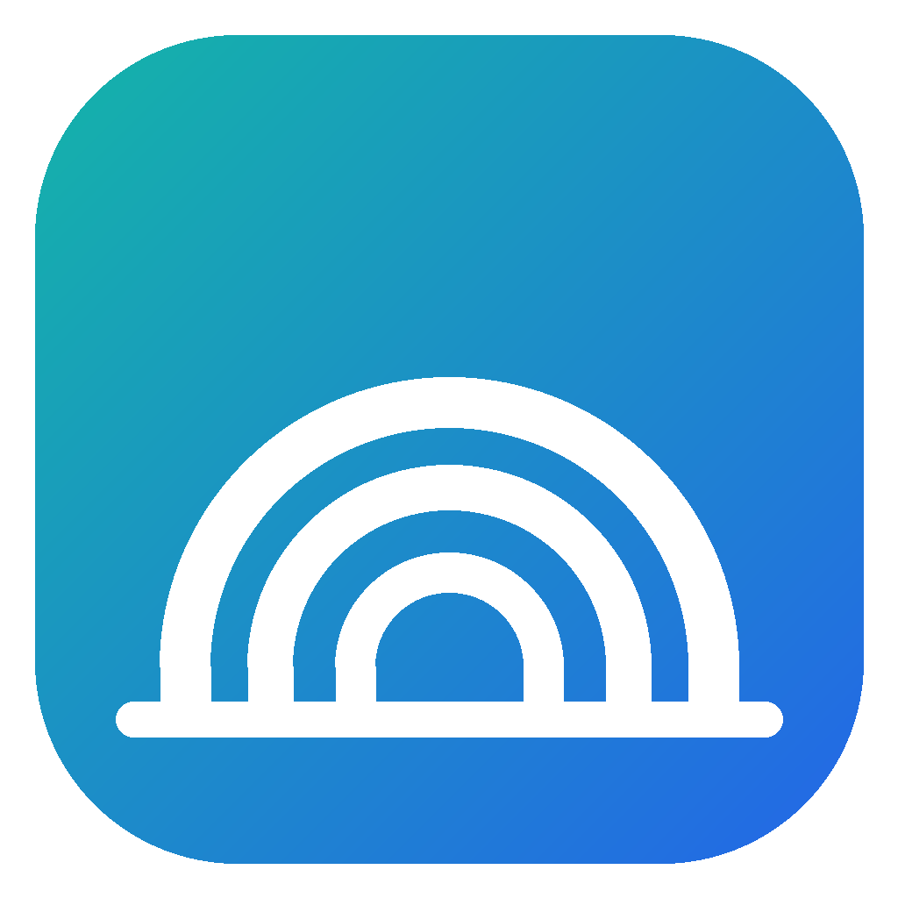
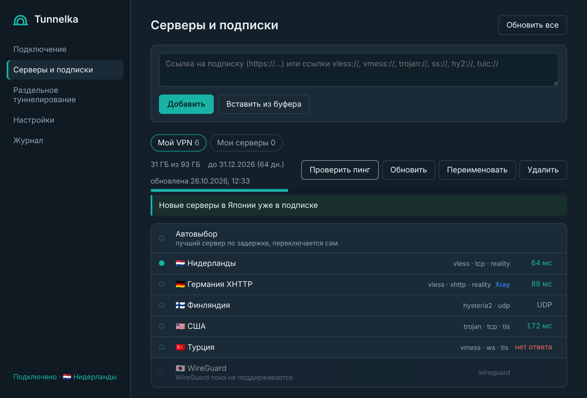
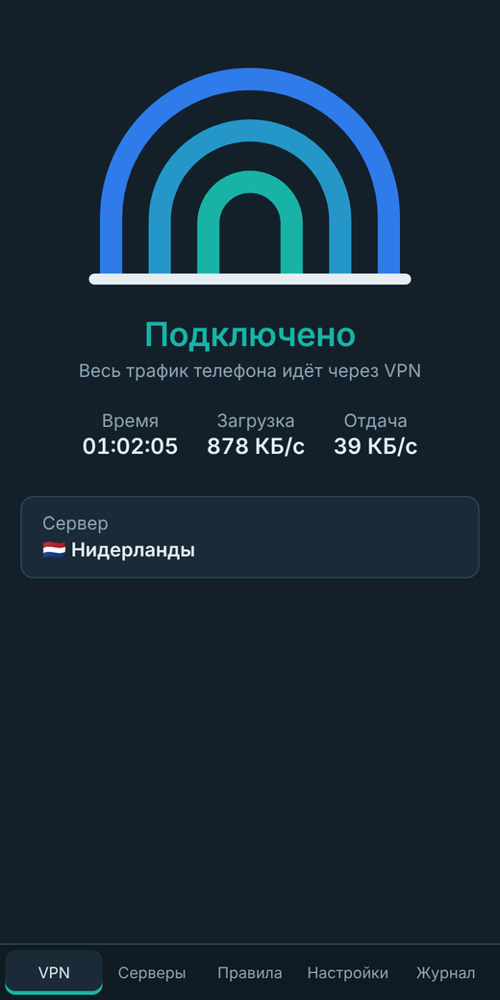

  

<h1 align="center">Tunnelka</h1>

  VPN-клиент для подписок VLESS, VMess, Trojan, Shadowsocks, Hysteria2 и TUIC. 
  Windows и Android.

  <a href="https://imvl1.github.io/Tunnelka_VPN/"><b>Скачать</b></a>
  &nbsp;&nbsp;
  <a href="https://github.com/ImVl1/Tunnelka_VPN/releases/latest">Последняя версия</a>

  
  &nbsp;
  

## Возможности

**Подписки.** Вставьте ссылку из бота или личного кабинета — Marzban, Remnawave, 3x-ui, Hiddify и другие панели. Tunnelka покажет остаток трафика и срок подписки, объявления провайдера и будет сама обновлять список серверов. Поддерживаются списки ссылок (обычные и в base64), JSON-конфиги sing-box и Xray. Отдельные серверы можно добавить ссылками.

**Протоколы.** VLESS (REALITY, TLS, XTLS Vision, XHTTP, WebSocket, gRPC, HTTPUpgrade), VMess, Trojan, Shadowsocks и Shadowsocks 2022, Hysteria2 с port hopping, TUIC, SOCKS5 и HTTP(S).

**Раздельное туннелирование.**
- По приложениям: «всё через VPN, кроме выбранных» или «только выбранные через VPN». У каждого режима свой список.
- По сайтам: списки «через VPN» и «напрямую» — домены, IP-адреса и подсети.
- Российские сайты и IP-адреса можно пустить напрямую одной галочкой.

**Подключение.**
- Автовыбор сервера с наименьшей задержкой и переключение серверов без разрыва соединения.
- Если выбранный сервер не отвечает, Tunnelka переключится на рабочий.
- Windows: режим TUN (весь трафик компьютера) или системный прокси. Если у провайдера TUN не даёт интернета, приложение само перейдёт на системный прокси.
- Android: системный VPN, работает для всех приложений.

**Безопасность.**
- Kill switch (Windows): если VPN неожиданно отключился, брандмауэр не выпустит программы в интернет напрямую. На Android — через системные «Постоянная VPN» и «Блокировать соединения без VPN».
- DNS-запросы и IPv6 не уходят мимо туннеля.
- Локальные порты выбираются случайно при каждом подключении и закрыты случайным паролем, поэтому другие программы не могут найти прокси и воспользоваться им.
- Файлы с паролями серверов удаляются сразу после запуска ядра.

**Удобство.** Значок в трее, запуск вместе с Windows и подключение при запуске (по умолчанию выключены), раздача VPN в локальную сеть с паролем, журнал работы.

## Системные требования

- Windows 10 или 11, 64 бит. Для режима TUN приложение запрашивает права администратора.
- Android 7.0 и новее, процессор arm64 (практически все современные телефоны).

## Как устроено

Интерфейс и логика написаны на Rust и [Tauri](https://tauri.app) и общие для обеих платформ. Подключения обслуживает [sing-box](https://github.com/SagerNet/sing-box); серверы, которые sing-box не поддерживает (XHTTP, VLESS Encryption), автоматически запускаются через [Xray-core](https://github.com/XTLS/Xray-core). На Android туннель создаёт системный VpnService вместе с [hev-socks5-tunnel](https://github.com/heiher/hev-socks5-tunnel).

## Лицензии

Код Tunnelka распространяется по лицензии MIT. Ядра поставляются в составе приложения под собственными лицензиями: sing-box — GPL-3.0, Xray-core — MPL-2.0, hev-socks5-tunnel — MIT.
